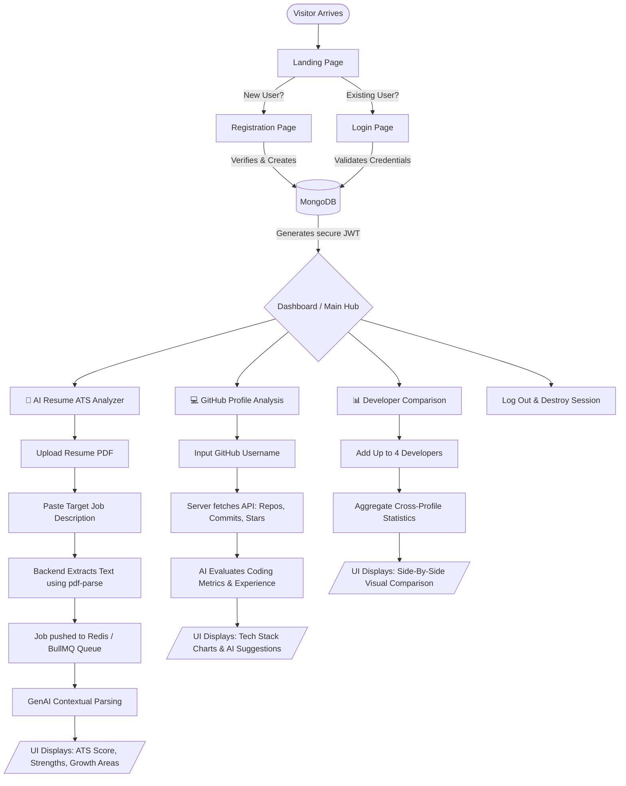
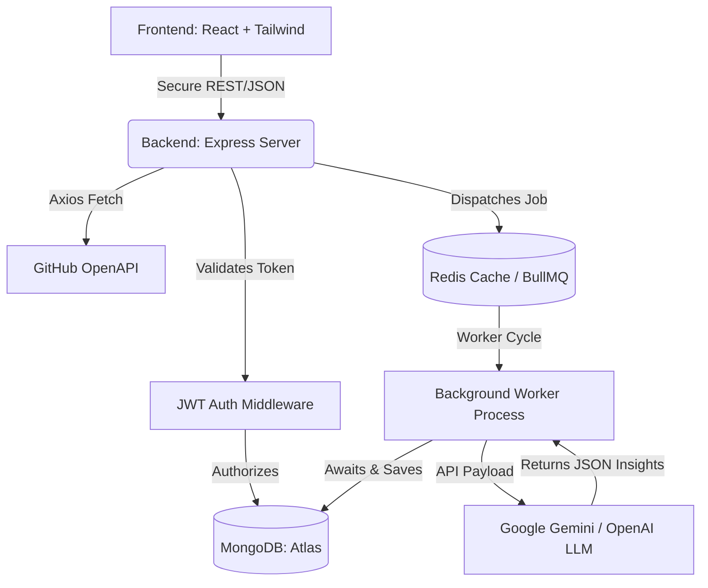
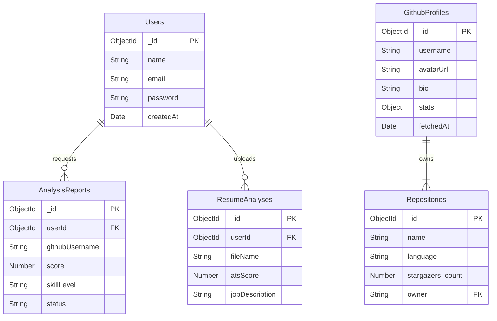
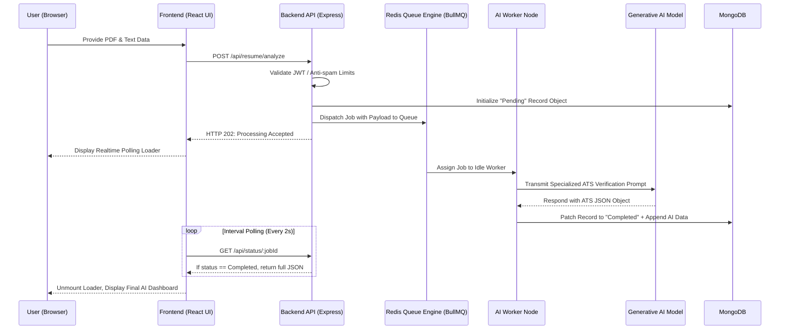

# 🚀 AI-Based Advanced GitHub Profile & Resume Analyzer: Comprehensive Project Documentation

---

## 📌 1. Executive Summary
The **AI-Based GitHub Profile & Resume Analyzer** is an intelligent, full-stack application designed to bridge the gap between technical recruiters and software developers. With the increasing competitiveness of the tech job market, developers need precise tools to evaluate their open-source contributions and tailor their resumes. This platform parses deep GitHub metrics and utilizes cutting-edge Generative AI (Google Gemini / OpenAI) to analyze resumes against specific Job Descriptions (JD) through an automated Applicant Tracking System (ATS) scoring simulation.

## ⚠️ 2. Problem Statement
- **Resume Rejections in the Dark:** Many qualified candidates are rejected by automated ATS systems because their resumes lack relevant keywords, yet they never know exactly *why*.
- **Unquantified Repositories:** Developers struggle to present a holistic, data-driven view of their GitHub profiles that goes beyond just commit counts. Recruiters rarely read code; they need summaries.
- **Manual Comparison Bottlenecks:** Recruiters and HR managers spend excessive hours manually comparing candidate portfolios, tracking forks, stars, and language dominance one by one.

## 💡 3. The Proposed Solution
An integrated SaaS-like dashboard that acts as a personal AI career assistant:
1. **AI Resume ATS Optimization:** Upload a PDF resume, paste a target Job Description (JD), and receive a highly nuanced AI-generated Score, identified Strengths, and Actionable Improvements.
2. **AI-Assisted GitHub Deep-Dive:** Instantaneous visual representation of a developer's GitHub statistics (language preferences, repository health) paired with AI-generated written feedback on their perceived "Skill Level."
3. **Data-Driven Comparative Analysis:** Head-to-head comparison of up to 4 developer profiles strictly based on raw data, displayed via beautiful Recharts.

---

## 🗺️ 4. Complete End-to-End User Flow (How It Works)

To fully grasp the capabilities of the platform, the following flowchart traces a user's journey from landing on the site, authenticating, and utilizing the platform's core AI tools.



### Flow Breakdown:
1. **Onboarding:** The user creates a secure account. Their session is managed via a JWT (JSON Web Token), meaning their session cannot be hijacked.
2. **The Dashboard Hub:** Upon login, the user accesses the main hub where they can choose between three distinct AI-driven avenues.
3. **Avenue A (The Recruiter Prep):** The user feeds a PDF and a job description. A background worker ensures the AI has all the time it needs without hanging the user's browser. The result is a rigorous keyword and structural assessment.
4. **Avenue B (The Portfolio Check):** The user enters their (or someone else's) GitHub handle. The server queries GitHub, formats the raw data, and tasks the AI to review the aggregated data, outputting charts and text.
5. **Avenue C (The Showdown):** Directly mapping multiple developer profiles onto the same comparative charts to expose who has more forks, stars, or commits in specific languages.

---

## ✨ 5. Comprehensive Feature Deep-Dive

### 🛡️ Authentication & Security
- **Stateless JWT-Based Sessions:** Highly secure JSON Web Tokens stored securely on the client side.
- **Bcrypt Password Cryptography:** Ensures that even on the event of a database breach, user passwords remain unintelligible.
- **Rate-Limiting & Helmet Middleware:** Protects the Node.js backend from DDoS attacks, brute force attempts, and unauthorized scraping bots.

### 🧠 Advanced AI-Powered Resume Parsing
- **Document Extraction (pdf-parse):** Bypassing standard file uploads by extracting the raw textual data from complex PDFs, preserving keywords.
- **GenAI Contextualization:** Using advanced prompts designed for Gemini/OpenAI, the engine is explicitly instructed to act as a harsh, enterprise-level ATS filter.
- **Algorithmic Deterministic Scoring:** Evaluates exact phrasing, keyword density, and experiential relevance to generate a realistic numeric score.

### 📈 GitHub API Analytics & Visualization
- **Multi-Endpoint Aggregation:** Simultaneously fetching user bio, repositories, commits, forks, and stargazers directly from GitHub's REST API.
- **Reactive Data Visualization:** Utilizing the `Recharts` library to render smooth, responsive Donut, Bar, and Line charts that physically map out a user's technology stack across years of commits.

### ⚙️ Asynchronous Processing (Message Queues)
- **Redis & BullMQ Engine:** Because Generative AI processing (fetching LLM responses) can take anywhere from 3 to 15 seconds, synchronous HTTP requests would cause the browser to freeze or timeout. This platform delegates GenAI network calls to a BullMQ background worker queue, allowing the server to poll and provide realtime progress updates.

---

## 🛠 6. Technology Stack & Justification

| Architecture Layer | Technology Used | Strategic Justification |
| :--- | :--- | :--- |
| **Frontend Framework** | React.js (Vite) | Offers lightning-fast Hot Module Replacement (HMR) and a strictly component-based UI for high maintainability. |
| **Styling & UI UX** | Tailwind CSS & Lucide React | Utility-first CSS removes the need for enormous stylesheets; enables highly responsive, glassmorphism-capable UI instantly. |
| **Backend Framework** | Node.js with Express.js | An asynchronous, non-blocking I/O model perfectly suited for querying GitHub and AI APIs concurrently. |
| **Database System** | MongoDB & Mongoose | Flexible NoSQL schema that easily absorbs unpredictable nested JSON objects returning from GitHub or AI endpoints. |
| **Artificial Intelligence** | Google Generative AI / OpenAI | Advanced Large Language Models (LLMs) used exclusively for context-aware, deep text comprehension and scoring logic. |
| **Memory Queuing System**| Redis + BullMQ | Essential for production-scale web apps to prevent server memory leaks and arbitrary timeouts on long-running AI workloads. |

---

## 🏛 7. System Backend Architecture

The macro-level diagram illustrating how traffic moves from the client, through middleware, into the queueing systems, and finally into the Database and AI servers.



---

## 📊 8. Database Entity Relationship (ER) Model

A highly robust NoSQL structure modeling the relational pathways despite utilizing MongoDB.



---

## 🔄 9. Asynchronous Sequence Diagram (The BullMQ Flow)

This sequence focuses explicitly on *how* the platform handles massive AI calculations asynchronously to preserve UX.



---

## 🏗 10. Core API Endpoints Routing

| API Endpoint | HTTP Method | Feature Description | Access / Security |
| :--- | :---: | :--- | :---: |
| `/api/auth/register` | `POST` | Registers a new user into the database securely. | Public / Unrestricted |
| `/api/auth/login` | `POST` | Cryptographically verifies user & dispatches JWT. | Public / Unrestricted |
| `/api/github/:username` | `GET` | Aggregates user's external GitHub data logically. | Protected (JWT Bearer) |
| `/api/resume/analyze` | `POST` | Translates PDF to text & queues AI ATS evaluation. | Protected (JWT Bearer) |
| `/api/compare/profiles`| `POST` | Processes up to 4 GitHub arrays for normalized comparison. | Protected (JWT Bearer) |

---

## 🚀 11. Complete Installation & Deployment Manual

### A. Local Development Environment:
1. **Clone the Repository:**
   ```bash
   git clone https://github.com/yourusername/AI-github-resume-analyzer.git
   cd AI-github-resume-analyzer
   ```
2. **Setup the Backend Node Server:**
   ```bash
   cd backend
   npm install
   ```
   *Create a secure `.env` file in the backend root directory:*
   ```env
   PORT=5000
   MONGO_URI=mongodb+srv://<admin>:<password>@cluster.mongodb.net/analyzer
   JWT_SECRET=super_secret_cryptographic_key_here
   GEMINI_API_KEY=your_gemini_or_openai_key
   REDIS_URL=redis://127.0.0.1:6379
   ```
3. **Setup the Frontend React Vite Server:**
   ```bash
   cd frontend
   npm install
   ```
4. **Boot Sequence (Requires 2 Terminal Windows):**
   - Terminal 1 (Backend API): `npm run dev`
   - Terminal 2 (React UI): `npm run dev`

### B. Scalable Production Deployment Strategy:
- **The Frontend (Vite/React)** is highly optimized for deployment on Edge Networking platforms like **Vercel** or **Netlify** with built-in CI/CD pipelines linked to GitHub.
- **The Backend (Express.js)** must be Dockerized to ensure environment parity and is best suited for deployment on **Hugging Face Spaces (Port 7860)**, **Render Web Services**, or an **AWS EC2 Ubuntu Instance**.
- **Data Persistence** relies on high-availability cloud services: **MongoDB Atlas** for database clustering, and up-time critical memory caching handled by a service like **Upstash** (Serverless Redis).

---

## 🏁 12. Final Conclusion
The **AI-Based GitHub Profile & Resume Analyzer** represents a next-generation approach to technical hiring and developer self-review. By merging highly stable, asynchronous backend messaging systems with the extraordinary logic capabilities of Generative AI, this platform transforms unstructured data into actionable, career-defining insights.

---
