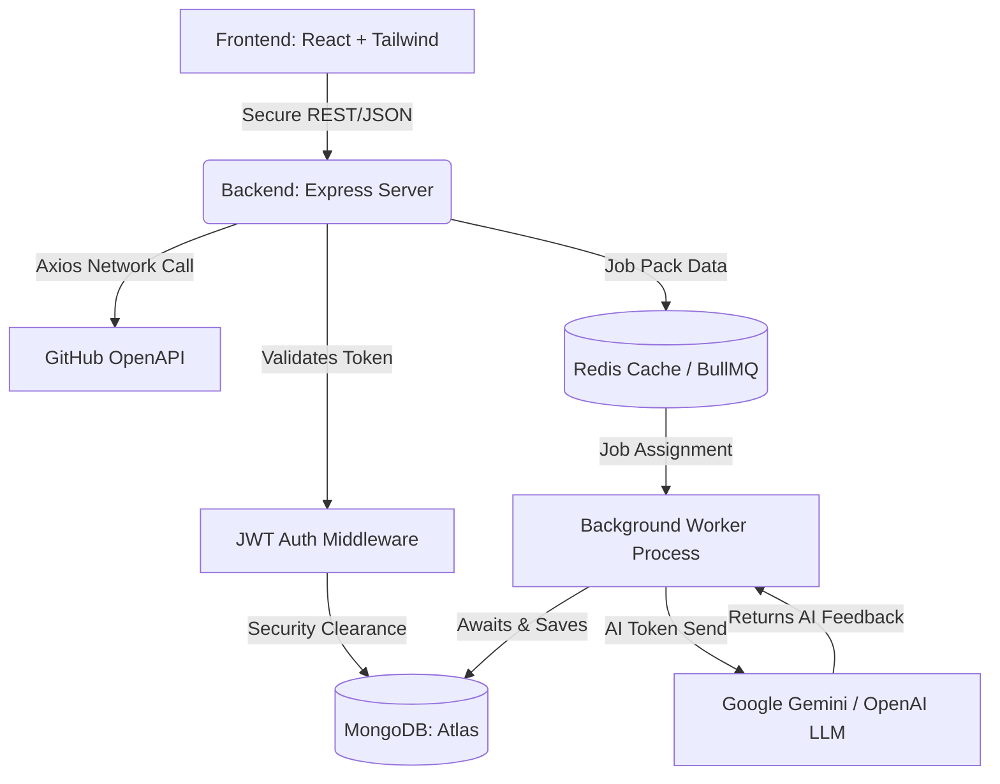
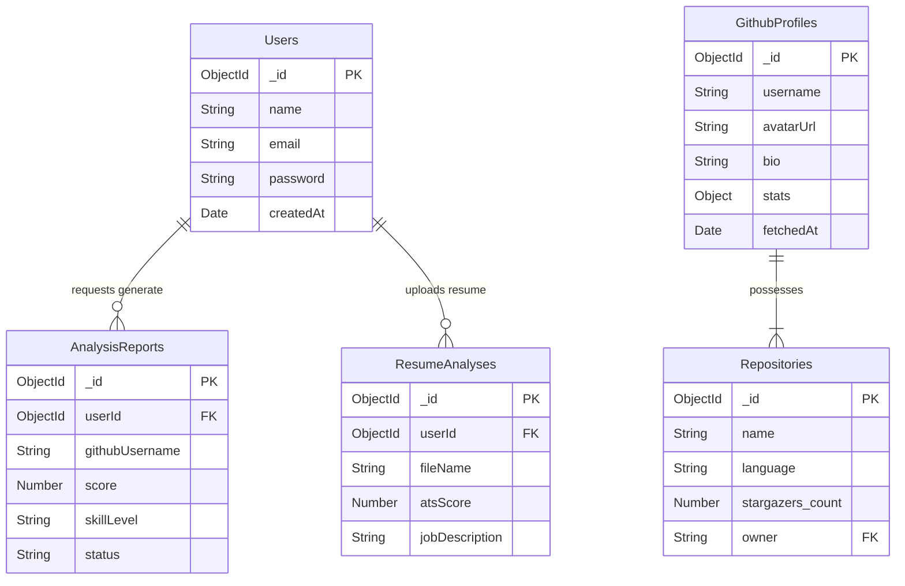
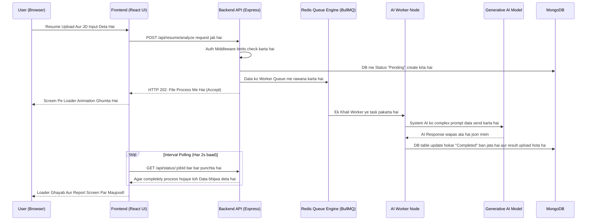

# 🚀 AI-Based Advanced GitHub Profile & Resume Analyzer: Comprehensive Project Documentation

---

## 📌 1. Executive Summary (Project Ka Mukammal Khulasa)
**AI-Based GitHub Profile & Resume Analyzer** ek behtareen intelligent, full-stack application hai jo recruiters aur software developers ke darmiyan maujood gap ko khatam karne ke liye banai gayi hai. Aaj ke tech hiring market me be-hisaab competition hai, isliye developers ko aese tools chahiye jo unke open-source kaam ko sahi se show karein. Yeh platform GitHub ki gehraiyon se metrics nikalta hai aur Generative AI (Google Gemini / OpenAI) ka istemal karke resumes ko Applicant Tracking System (ATS) ke mutabiq automatic tareeqe se analyze aur score karta hai.

## ⚠️ 2. Problem Statement (Yeh Banane Ki Zarurat Kyun Pari?)
- **Andhere Mein Rejections:** Bohat se qabil aur ache candidates ka resume ATS system reject kardeta hai kyunke unke paas JD (Job Description) ke mutabiq sahi keywords nahi hote, aur candidates ko waja bhi pata nahi chalti.
- **Sirf Commits Kafi Nahi:** Aksar developers apne GitHub portfolio ki asal taqat dikha nahi pate. Recruiters ke paas itna waqt nahi hota ke wo code parhein; unhe quick, visual aur clean summaries chahiye hoti hain.
- **Manual Comparison Tiring Hai:** HR managers aur recruiters ko do ya chaar candidates ki GitHub profiles, unke forks, stars, aur programming languages ko manual tab khol kar compare karne mein bht waqt lagta hai.

## 💡 3. The Proposed Solution (Hamara Advanced Solution)
Ek SaaS-style dashboard jo AI career assistant ke taur pe kaam karta hai:
1. **AI Resume ATS Check:** Apna PDF resume upload karein aur uske samne Job Description lagayein. AI aapko ek zabardast report generate karke dega jis mein aapka Score, aapki Taqat (Strengths), aur Weaknesses shamil hongi.
2. **AI-Assisted GitHub Insights:** Profile username likhein aur foran ek visual dashboard payein jis mein developer language trends, repo conditions, aur AI ki taraf sey "Skill Level" evaluation written form mein mile.
3. **Data-Driven Head-to-Head Comparison:** Ek sath 4 developers ki ids dalein aur system sabki details compare karke Recharts ke zariye khoobsurat bar aur radar charts mein farq bata dega.

---

## 🗺️ 4. Complete End-to-End User Flow (App Kaise Kaam Karti Hai)

Yeh user journey flowchart completely samjhata hai ke jab ek naya banda aapki website par aata hai, tou wo registration se le kar AI tools ko kaise use karta hai.

```mermaid
graph TD
    Start([Visitor Aata Hai]) --> LP[Landing Page]
    LP --> |Naya User?| Reg[Register Page]
    LP --> |Purana User?| Log[Login Page]
    
    Reg --> |Account Banata Hai| DB[(MongoDB)]
    Log --> |Details Check Karta Hai| DB
    DB --> |Secure Token Deta Hai| Dash{Main Dashboard}
    
    Dash --> Feature1[🧠 AI Resume ATS Analyzer]
    Dash --> Feature2[💻 GitHub Profile Analysis]
    Dash --> Feature3[📊 Developer Comparison]
    Dash --> LogOut[Log Out / Session Khatam]
    
    %% AI RESUME FLOW
    Feature1 --> R1[Resume PDF Upload Ka Option]
    R1 --> R2[Job Description Text Paste Karna]
    R2 --> R3[Backend pdf-parse se text parhta hai]
    R3 --> R4[Background Qeueue (BullMQ) me task bhejta hai]
    R4 --> R5[GenAI Context Aur Keywords Parhta Hai]
    R5 --> R6[/Screen Par: ATS Score, Strengths, Weaknesses Aati Hain/]
    
    %% GITHUB ANALYSIS FLOW
    Feature2 --> G1[GitHub Username Likhna]
    G1 --> G2[GitHub API Se Commits aur Repos Lana]
    G2 --> G3[AI Coding Skills Ko Evaluate Karta Hai]
    G3 --> G4[/Screen Par: Tech Stack Charts aur AI Feedback Nazar Aata Hai/]
    
    %% COMPARE FLOW
    Feature3 --> C1[1 se 4 Usernames Daalna]
    C1 --> C2[Sabka Exact Data Combine Karna]
    C2 --> C3[/Screen Par: Side-By-Side Visual Comparison Dikhana/]
```

### Flow Ka Mukammal Breakdown:
1. **Onboarding:** User apna account banata hai. Iska data JWT (JSON Web Token) ke zariye frontend aur backend me safely verify kiya jata ha jo hacking se mehfooz hai.
2. **Dashboard Actions:** Login hone ke baad user ke paas 3 major option hote hain jo AI se chale hain.
3. **Route 1 (Resume Testing):** Jab user resume filter karta hai, tou request itni bhari hoti hai ke agar direct bhejein tou website freeze ho sakti hai. Isliye backend queue system banaya gaya hai. AI poora feedback lekar aata hai.
4. **Route 2 (Dashboard Maker):** Kisi dusre candidate ka handle search karwaya, backend ne original GitHub REST API se data jama kiya, graphs banaye, aur phir AI se pootcha ke yeh data kaisa hai. AI ne response diya jo text form me show hota hai.
5. **Route 3 (Versus Mode):** Multiple developers ka data le kar unki language (like Python vs JS) ki lines of code ko map karna.

---

## ✨ 5. Comprehensive Feature Deep-Dive (Technical Tafseelat)

### 🛡️ Authentication & Security
- **Stateless JWT-Based Sessions:** Client-side pe strictly managed JSON Web Tokens jo bina backend loads ke heavy traffic handle karte hain.
- **Bcrypt Passwords Registration:** Agar database hack bhi hojaye tou kisi ko users ke original passwords ka andaza nahi ho sakta kyunke wo hashed hote hain.
- **Rate-Limiting & Helmet Middleware:** Express backend ko dushman bots aur spamming attacks se bachane ke liye strict configurations.

### 🧠 Advanced AI-Powered Resume Parsing
- **PDF Text Processor (pdf-parse):** Sirf document lena kafi nahi hota, uske andar ke complex structure ko break karke raw text keyword nikalna taake AI samajh sake.
- **GenAI Contextualization:** Gemini/OpenAI ki advance natural language processing. Prompts ko specially aese shape kiya gaya hai ke wo bilkul Strict HR ATS System ki tarah sochain.

### 📈 GitHub API Analytics & Dashboarding
- **Parallel Endpoints Fetching:** User ki basic info, repositories list, aur stars ki lists ko simultaneously mangwana taake wait time kam ho.
- **Reactive Data Visualization:** React ke ander `Recharts` module ko implement kiya hai. Yeh graphs responsive (mobile-friendly) hotay hain aur data filter badlay tou smoothly animated hoker refresh hote hain.

### ⚙️ Asynchronous Processing (Message Queues)
- **Redis & BullMQ Engine:** API calls aur Generative AI dono bohut slow internet processes hotay hain (lagbhag 5-10 second tak waqt). Is beech app crash na kare aur UI pe progress show ho, us maqsad ke liye Redis queue chalai gayi hai jise BullMQ control karta hai. Is point se pata chalta hai ke project Enterprise-Grade Architecture pe ha.

---

## 🛠 6. Technology Stack & Justification (Kyun Istemal Ki Gayi?)

| System Layer | Installed Tech | Istemaal Karne Ki Waja / Fayde |
| :--- | :--- | :--- |
| **Frontend Framework** | React.js (Vite) | Lightning-fast development speed aur reusable components banane ki azadi. |
| **Styling & UI UX** | Tailwind CSS & Lucide React | Classes likhne ki zarurat khatam. Modern aur attractive designs bohat tezi se bante hain. |
| **Backend Framework** | Node.js with Express.js | Asynchronous backend jo AI aur GitHub donu APIs ko ek sthy bina ruke process kar sakta hai. |
| **Database System** | MongoDB & Mongoose | GitHub aur AI se result hamesha JSON strings me aatay hain, Mongoose inko ba-asani validate kar leta hai. |
| **Artificial Intelligence** | Google Generative AI / OpenAI | Deep learning Large Language Models jo resumes ki sense create kar ke scoring de sakte hain. |
| **Memory Queuing System**| Redis + BullMQ | Background worker jobs run karne aur timeouts rokne ke liye cloud-scale industry standard. |

---

## 🏛 7. System Backend Architecture (App Ka Asal Structure)

Yeh macro-level architecture flow chart zahir karta hai ke REST APIs kaise middleware se touch hotay hain aur queue system pe task pass hota hai.



---

## 📊 8. Database Entity Relationship (ER) Model

Data ek dusray sey relation banata hai (Jaise Ek User ke Multple Reports hosakti hain), ye relationship is diagram me dekha ja sakta hai.



---

## 🔄 9. Asynchronous Sequence Diagram (AI Processing Execution Flow)

Ye technical sequence diagram highlight karta hai frontend ki HTTP request browser loading ko rok kar background processing kaise initiate karti hai aur Real Time response laati hai.



---

## 🏗 10. Core API Endpoints Routing (Backend ke raste)

| API Endpoint Path | HTTP Method | Application Feature | API Security |
| :--- | :---: | :--- | :---: |
| `/api/auth/register` | `POST` | User ki details lay kar database tables update karna | Public Access |
| `/api/auth/login` | `POST` | Cryptographically verify encrypt password aur JWT banana | Public Access |
| `/api/github/:username` | `GET` | User ki details Github server se jama karna | Protected (Login Required) |
| `/api/resume/analyze` | `POST` | PDF to text translate or queue task upload | Protected (Login Required) |
| `/api/compare/profiles`| `POST` | Chaar(4) profiles mangwana for head-to-head tracking| Protected (Login Required) |

---

## 🚀 11. Complete Installation & Deployment Manual (Server Pe Kaise Lagayein?)

### A. Local Development Environment (Apne PC Par Chalanay ke liye):
1. **GitHub Se Clone Karein:**
   ```bash
   git clone https://github.com/yourusername/AI-github-resume-analyzer.git
   cd AI-github-resume-analyzer
   ```
2. **Setup the Node.js Backend:**
   ```bash
   cd backend
   npm install
   ```
   *`.env` file create krein (Secrets ke liye):*
   ```env
   PORT=5000
   MONGO_URI=mongodb+srv://<admin>:<password>@cluster.mongodb.net/analyzer
   JWT_SECRET=super_secret_cryptographic_key_here
   GEMINI_API_KEY=your_gemini_or_openai_key
   REDIS_URL=redis://127.0.0.1:6379
   ```
3. **Setup the React Vite Frontend Server:**
   ```bash
   cd frontend
   npm install
   ```
4. **Boot Sequence (Run karne ka Tarika):**
   - Terminal 1 (Backend API Start): `npm run dev`
   - Terminal 2 (React UI Start): `npm run dev`

### B. Production Deployment Strategy (Internet Par Live Karna):
- **Frontend App:** Frontend code bohut halka aur optimized hai jo Edge networks (like **Vercel** ya **Netlify**) pe continuous deployment pipeline set karke host ho sakta hai.
- **Backend App:** Node server API ko Docker container bana ker kisi heavy web cloud jaise **Hugging Face Spaces (Port 7860)**, ya **Render Web Services** per rakhna behtar ha.
- **Data Save Karna:** Storage ke liye hum **MongoDB Atlas** cloud use kartay hain, jab ke queue system speed manage karne k liye **Upstash Serverless Redis** ko cloud pe attach karna safe rahay ga.

---

## 🏁 12. Final Conclusion
**AI-Based GitHub Profile & Resume Analyzer** aj ke dor ki jaded (next-generation) technical hiring process ko automatic banati hai. High scale background asynchronous processing, queue management, aur dunya ke ameer tarin Large Language Models ki integration (Generative AI) is platform ko aam basic portfolios ki categories se upper level par le aati hai. Yeh resume mein as a "Full Stack & System Architecture Project" add hone ke qabil hai!

---
